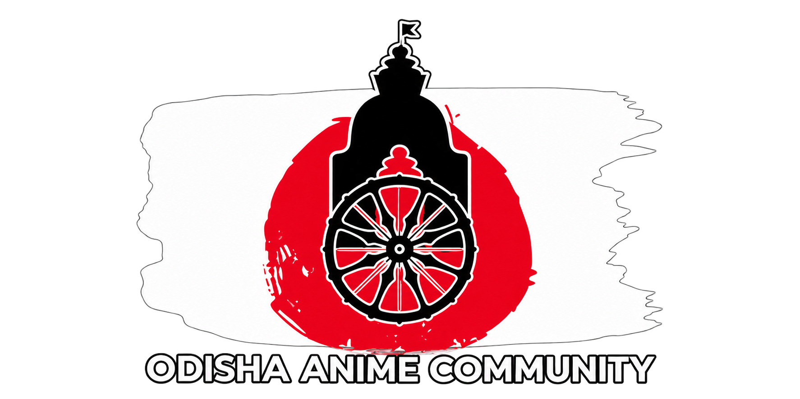

<div align="center">

<a href="https://joinoac.in" target="_blank" rel="noopener noreferrer">
  
</a>

# ⛩️ Odisha Anime Community (OAC) — Official Link Hub

[](https://vitejs.dev/)
[](https://react.dev/)
[](https://www.typescriptlang.org/)
[](https://tailwindcss.com/)
[](SECURITY.md)
[](LICENSE)

<br />

**The definitive, high-performance digital link portal and Linktree alternative engineered for the Odisha Anime Community (OAC).**  
*Built with ❤️ for Odisha Anime Community by [Crystal Studio Labs](https://github.com/Crystal-Studio-Labs).*

[Explore Website](https://joinoac.in) • [Get OCD 2026 Tickets](https://greet.fydo.in/otaku-community-day-2026) • [Report Vulnerability](SECURITY.md) • [Contributing](CONTRIBUTING.md)

</div>

---

## 📖 Overview

The **Odisha Anime Community (OAC) Link Hub** is a standalone, ultra-responsive web application designed to unite anime fans, cosplayers, artists, gamers, and music lovers across Odisha. Built as a custom alternative to third-party link services, it pairs aesthetic Japanese visual novel styling with high-performance modern web engineering.

### ✨ Highlights
- **100% White-Label Front-End UI**: The rendered website UI is strictly community-first with zero external studio branding or third-party Linktree references. Studio credits are maintained exclusively in repository source files.
- **Cinematic Anime Aesthetics**: Akihabara neon street scene background, deep void `#0C0C0C` dark mode, crimson `#D91515` energy accents, and solar gold `#F3B334` highlights.
- **Physical Tactile Card Expansion**: Cards scale smoothly on click (`scale-105`), trigger a radial gold/crimson aura burst, and morph their action buttons into loading spinners before redirecting.
- **Interactive Japanese Typewriter**: Character-by-character typewriter and deletion loop for `オディシャ・アニメ・コミュニティ` with a pulsing crimson cursor.
- **60 FPS Particle Engine**: Canvas rendering floating sakura cherry blossoms, glowing embers, and interactive mouse-breeze repulsion (with one-click header VFX toggle).
- **Direct Warp Routing**: Supports instant query parameter shortcuts (e.g. `?go=tickets`, `?go=halloween`, `?go=discord`) with an anime warp screen.
- **Event QR & Share Suite**: Integrated high-resolution QR code modal with 1-click PNG download for event flyers and instant social share triggers.
- **Full-Spectrum Mobile Responsiveness**: Dynamic viewport height (`min-h-[100dvh]`), true 16:9 aspect ratio banners (`aspect-[16/9]`), and balanced 3-column action toolbars.
- **100% Visual Card Coverage**: Every card features an authentic, bicubic-scaled thumbnail from live community channels and official posters.
- **Production-Hardened Security**: Audited with `npm audit` to **0 vulnerabilities** across all dependencies.

---

## 🎨 Design System & Palette

| Token | Hex Value | Semantic Application |
| :--- | :--- | :--- |
| **OAC Void Black** | `#0C0C0C` | Master background, card depths, and modal overlays |
| **OAC Surface Dark**| `#121212` | Elevated card surfaces and navigation containers |
| **OAC Crimson Red** | `#D91515` | Action buttons, pulsing radar beacons, and flame glows |
| **OAC Solar Gold**  | `#F3B334` | Headings, badge highlights, and radiant hover borders |
| **Cyber Purple**   | `#8B5CF6` | Halloween party specials, cosplay showcases, and nightlife |
| **Emerald Green**  | `#10B981` | Stalls, vendor applications, and WhatsApp community chats |
| **Discord Blurple**| `#5865F2` | Voice servers, gaming tournaments, and lounge cards |

---

## 🎟️ Active Passes & Community Link Stream

The single-page stream in [`src/data/links.ts`](src/data/links.ts) is arranged in priority order:

1. **🎟️ Otaku Community Day 2026 Tickets** (`isFeatured: true`) — Flagship anime convention pass at 3rd Space, Rasulgarh, Bhubaneswar (Nov 22, 2026).
2. **🎃 Coslabs Halloween Party 2026** (`isFeatured: true`) — Spooky cosplay party, games, cake, and anime DJ night passes.
3. **🌟 OTAKU COMMUNITY DAY TALENT HUNT** — Auditions for singing, dancing, skits, instruments, and stage acts.
4. **🛍️ OTAKU COMMUNITY DAY Vendor & Stall Applications** — Merchandise, art prints, manga, and food stall registrations.
5. **🤝 OAC CREW 001 — Volunteer Applications** — Core team recruitment for stage, crowd control, and photography.
6. **🌐 Visit Official Website (joinoac.in)** — Master community portal with complete club history and galleries.
7. **📸 Follow on Instagram (@odisha.anime.community)** — Daily reels, cosplay showcases, and event teasers.
8. **💬 Join OAC WhatsApp Community** — Official community chat and instant announcement alerts.
9. **🎮 Join OAC Discord Server** — 5,000+ member server with voice lounges, bot games, and watch parties.
10. **📺 Subscribe on YouTube (@OdishaAnimeClub)** — Event aftermovies, performance recordings, and cosplay interviews.

---

## 📱 Mobile Screen Ratios & Flex Ergonomics

The layout adapts seamlessly across all mobile form factors:
- **Small Screens (`xs: 375px`)**: iPhone SE, Galaxy A-series, and compact devices receive optimized font scaling and safe edge padding (`px-3.5`).
- **Dynamic Viewport (`100dvh`)**: Mobile address bar collapsing and expansion never trigger layout displacement.
- **Aspect Ratio Locking**: Featured event cards utilize `aspect-[16/9]` containers to prevent distortion on wide or narrow screens.
- **Thumb Targets**: All buttons, links, and modal triggers maintain WCAG-compliant touch targets of at least **42–44px**.

---

## 🚀 Quick Start & Local Setup

### Prerequisites
- **Node.js**: `v18.0.0` or higher (Node 20+ LTS recommended)
- **npm**: `v9.0.0` or higher

```bash
# 1. Clone repository
git clone https://github.com/Crystal-Studio-Labs/OAC-Linktree.git
cd OAC-Linktree

# 2. Install dependencies (honoring Drive D: cache policy on Windows)
npm install --cache D:\npm-cache

# 3. Start local development server (accessible via IPv4 & IPv6)
npm run dev -- --host 0.0.0.0

# 4. Open in browser
# http://localhost:5173/
```

### Production Build & Preview
```bash
# Type check and build static production bundle
npm run build

# Preview production build locally
npm run preview
```

---

## 🛠️ How to Manage Links (`src/data/links.ts`)

Per the project directives in [`llms.txt`](llms.txt), both human contributors and AI coding agents are strictly restricted to editing [`src/data/links.ts`](src/data/links.ts):

```typescript
// To add or update an event card:
{
  id: 'my-new-event',
  title: 'My Event Title',
  subtitle: 'Short 1-2 sentence description.',
  url: 'https://greet.fydo.in/my-event',
  isFeatured: true,               // true = 16:9 Hero Card | false = Compact Row
  badge: '🔥 TICKETS LIVE',
  badgeColor: 'red',              // 'red' | 'gold' | 'emerald' | 'purple' | 'blue'
  thumbnailUrl: '/images/poster.png',
  highlightGlow: true,
  actionText: 'Book Tickets',
  iconName: 'Ticket',
}
```

---

## 📁 Repository Structure

```
OAC-Linktree/
├── .github/
│   └── workflows/
│       └── deploy.yml          # Automated GitHub Pages CI/CD workflow
├── public/
│   ├── favicon.ico             # 32x32 multi-resolution browser icon
│   ├── favicon.png             # 64x64 retina browser tab icon (5.6 KB)
│   ├── favicon-32x32.png       # 32x32 icon
│   ├── favicon.svg             # Vector SVG favicon with glowing anime halo
│   ├── apple-touch-icon.png    # 180x180 iOS touch icon
│   ├── icon-192.png            # 192x192 Android PWA icon
│   ├── icon-512.png            # 512x512 Android PWA splash icon
│   ├── site.webmanifest        # PWA application descriptor
│   ├── images/
│   │   ├── akihabara-bg.jpg    # Akihabara neon street scene backdrop
│   │   ├── ocd-poster.png      # Otaku Community Day 2026 poster
│   │   ├── coslabs-halloween.png # Halloween Party 2026 poster
│   │   ├── ocd-talent-hunt.jpg # Cosplay & talent performance photography
│   │   ├── ocd-stalls.jpg      # Convention merchandise & stall photo
│   │   ├── oac-crew.png        # Official volunteer crew banner
│   │   ├── oac-website.png     # Official OAC brand emblem badge
│   │   ├── oac-instagram.jpg   # Live Instagram profile avatar
│   │   ├── oac-whatsapp.jpg    # Live WhatsApp community avatar
│   │   ├── oac-discord-tile.png# Discord Clyde badge tile
│   │   ├── oac-youtube.jpg     # Official YouTube channel avatar
│   │   ├── og-preview.jpg      # 1200x630 custom Open Graph social card
│   │   └── og-preview.png      # High-res Open Graph banner
│   ├── llms.txt                # AI agent instructions (public mirror)
│   └── llm.txt                 # AI agent instructions (compat alias)
├── docs/                       # Pre-compiled static release for GitHub Pages (/docs)
├── src/
│   ├── components/
│   │   ├── Footer.tsx          # Community-only white-label footer
│   │   ├── LinkCard.tsx        # Responsive card with click expansion & 16:9 banner
│   │   ├── ParticleBackground.tsx # 60 FPS sakura petals & embers canvas
│   │   ├── ProfileHero.tsx     # Japanese typewriter, anime aura & action toolbar
│   │   ├── QRCodeModal.tsx     # Branded event QR scanner & PNG downloader
│   │   ├── ShareModal.tsx      # WhatsApp, Twitter, Telegram & URL copy modal
│   │   ├── SocialLinks.tsx     # Touch-friendly quick-action social icon bar
│   │   └── Toast.tsx           # Floating notification toast
│   ├── data/
│   │   └── links.ts            # Master link registry & official profile data
│   ├── types/
│   │   └── index.ts            # TypeScript interfaces (LinkItem, SocialLink)
│   ├── utils/
│   │   └── assets.ts           # Subpath asset URL resolution helper
│   ├── App.tsx                 # Master root layout & warp routing controller
│   ├── index.css               # Design tokens, keyframes & anime animations
│   └── main.tsx                # React 18 client root mounting
├── .cursor/rules/              # Cursor 2.0+ modular agent rules
├── .cursorrules                # Cursor IDE agent instructions
├── .github/
│   ├── copilot-instructions.md # GitHub Copilot workspace agent instructions
│   └── workflows/deploy.yml    # GitHub Actions deployment workflow
├── .windsurfrules              # Windsurf Cascade agent instructions
├── AGENTS.md                   # Standard agent specification (Gemini, Antigravity)
├── CHANGELOG.md                # Release versioning history
├── CLAUDE.md                   # Anthropic Claude Code agent instructions
├── CODE_OF_CONDUCT.md          # Community standards & pledge
├── CONTRIBUTING.md             # Contribution rules & link schema
├── index.html                  # SEO, Open Graph tags & JSON-LD structured data
├── LICENSE                     # Source-Available Restricted License
├── llms.txt                    # System boundaries & AI agent directives
├── llm.txt                     # AI agent directives alias
├── package.json                # Project dependencies (Vite 6, React 18, Tailwind)
├── tailwind.config.js          # Tailwind tokens, breakpoints (xs: 375px) & animations
├── tsconfig.json               # TypeScript compiler options
└── vite.config.ts              # Vite configuration with conditional base path
```

---

## 🔒 Security & Privacy

This project strictly adheres to modern security standards:
- **0 Dependencies Vulnerabilities**: Confirmed clean by `npm audit`.
- **Safe URI Protocols**: Outbound links enforce `/^(https?:\/\/|mailto:)/i` to prevent script execution exploits.
- **Strict Privacy**: Enforces `referrer policy="strict-origin-when-cross-origin"` and `X-Content-Type-Options: nosniff`.
- **Origin Isolation**: All external links pair `target="_blank"` with `rel="noopener noreferrer"`.

For responsible disclosure, please consult [`SECURITY.md`](SECURITY.md).

---

## 🌐 GitHub Pages Deployment Guide

The repository supports dual automated deployment workflows:

### Method 1: GitHub Actions (Recommended)
1. In your GitHub repository, navigate to **Settings** > **Pages**.
2. Under **Build and deployment** > **Source**, choose **GitHub Actions** from the dropdown.
3. Every commit pushed to `main` automatically builds and deploys `./dist` via [`.github/workflows/deploy.yml`](.github/workflows/deploy.yml).

### Method 2: Deploy from Branch (Instant Zero-Config Fallback)
1. In your GitHub repository, navigate to **Settings** > **Pages**.
2. Under **Build and deployment** > **Source**, choose **Deploy from a branch**.
3. Under **Branch**, select either:
   - **`gh-pages`** and folder **`/ (root)`**, OR
   - **`main`** and folder **`/docs`**.
4. Click **Save**. GitHub Pages will immediately serve the pre-compiled production build.

### Custom Domain Configuration
To bind a custom domain (e.g. `links.joinoac.in`):
1. Place a file named `CNAME` in the `public/` directory containing your domain name.
2. Add a `CNAME` DNS record at your domain provider pointing to your GitHub Pages URL (`crystal-studio-labs.github.io`).

---

## 📜 License & Intellectual Property

This software and its custom design system are governed by the **Source-Available Restricted License**:

```
Copyright (c) 2020–2026 Odisha Anime Community & Crystal Studio Labs.
All rights reserved.
```

- **Permitted**: Public inspection, evaluation, and community contributions via pull requests.
- **Prohibited**: Modifying, redistributing, rebranding, reselling, or commercializing this software or its visual designs as a commercial product or paid service.

Read the full terms in the [`LICENSE`](LICENSE) file.
